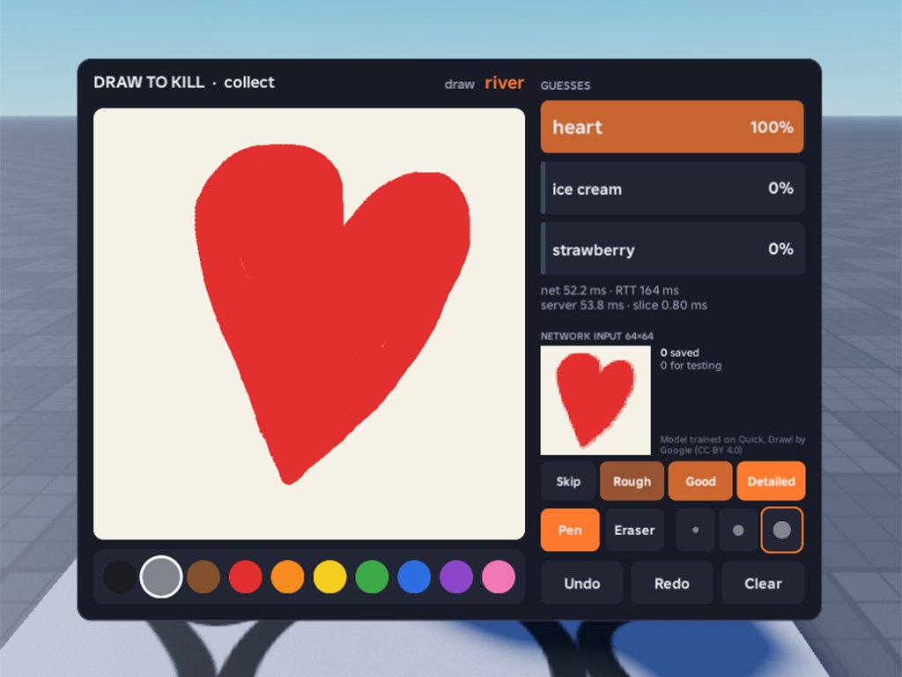
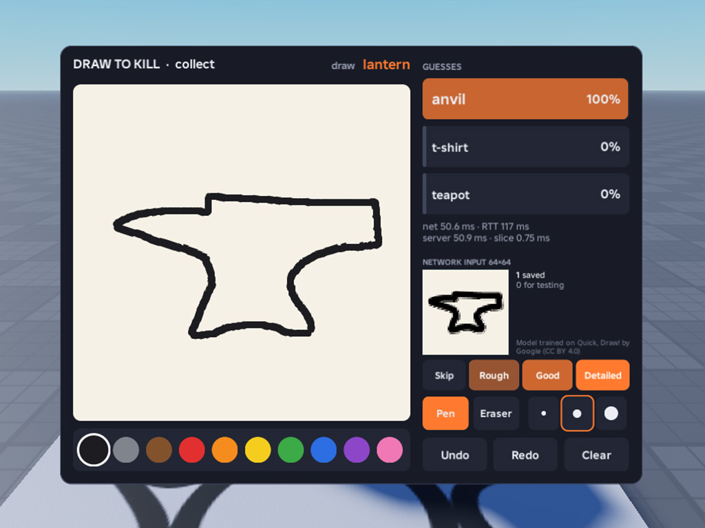
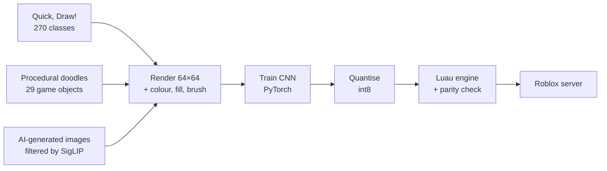

# Sketch Recognition

**A neural network that recognises players' drawings in real time, running inside a Roblox game.**

Trained in PyTorch, quantised to int8, and executed on the Roblox server by a custom Luau inference engine, because Roblox has no machine-learning runtime.

  
  

Built as the core mechanic of a game prototype: draw a weapon or a disaster over a crowd of enemies, and it comes to life.

## Highlights

- **299 classes:** 270 from Google's Quick, Draw! dataset, plus 29 game objects (bomb, rocket, black hole, …) that no dataset has.
- **77.4% top-1 / 92.2% top-3** on 270,000 Quick, Draw! validation drawings, and **99.9%** on the game objects.
- **~70 ms per drawing** on the game server, split into slices under 1 ms per frame so the game never stutters.
- **9.9 M parameters, 9.9 MB** of int8 weights.
- **Works with colour:** filled-in, painted and coloured drawings.

## How it works

**1. Data for things no dataset has.** The 29 game objects come from three sources:
- code that draws quick, wobbly doodles the way people do;
- images generated locally with FLUX.1-schnell, converted back into strokes;
- a SigLIP vision-language model that rejects generated images that don't match their label (146k kept of 404k).

**2. Colour.** Quick, Draw! only has black outlines. Training adds colours, imperfect fills, brush strokes and hatching, so a filled red heart is still a heart.

**3. Training.** A CNN with a 4 × 64 × 64 input (ink + colour), distilled from an earlier 40×40 model, trained for 72 hours on one RTX 3080 Ti.

**4. Running it in Roblox.** Batch-norm is folded into the convolutions, weights are quantised to int8, and a Luau engine runs the forward pass. An automatic parity check requires the same top guess as the Python reference on every test drawing, with outputs at most 0.0003 apart.

**5. Safe by design.**
- Only the server sees a drawing; other players never receive it.
- Each submission needs a single-use permission from the server.
- Every model was also checked for false alarms (a normal drawing mistaken for a weapon), because in the game those would fire.

## Results

| Test set | 64×64 (final) | 40×40 (previous) |
|---|---:|---:|
| Quick, Draw!, black ink | 77.4% | 77.8% |
| Quick, Draw!, filled in | **73.3%** | 72.3% |
| Detailed drawings | **97.8%** | 88.2% |
| Game objects | **99.9%** | 99.8% |
| False alarms, filled drawings | **0.16%** | 0.22% |

**Limitations:**
- A filled-in "cursed face" is often read as "face", because the fill hides the features.
- The detailed-drawing test set is small (93 drawings).

## Repository

| Folder | Contents |
|---|---|
| `training/` | Python: data, doodle generator, training, evaluation, export |
| `luau/` | Roblox code: rasteriser, recognition queue, test UI, checks |
| `model/final64/` | Final model: Roblox file (`.rbxmx`), int8 weights, PyTorch checkpoint |
| `results/` | Evaluation results |
| `docs/` | Studio setup guide and images |

**Try it in Roblox Studio:**
1. Insert `model/final64/final64.rbxmx`.
2. Wire up the scripts as described in [docs/studio-setup.md](docs/studio-setup.md).
3. Press Play and draw.

**Train it yourself:** `pip install -r requirements.txt`. The datasets (~690 GB) aren't included; start with `training/download.py`.

## Built with

Python · PyTorch · NumPy · Luau · Roblox Studio · FLUX.1-schnell · SigLIP

## Credits

- [Quick, Draw! dataset](https://github.com/googlecreativelab/quickdraw-dataset) by Google, CC BY 4.0. The model is trained on it and keeps that attribution.
- FLUX.1-schnell (Black Forest Labs) and SigLIP (Google), both Apache-2.0, used locally for training data.

Code: MIT, see [LICENSE](LICENSE).